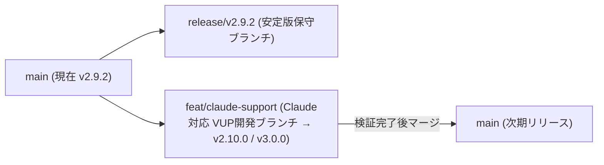
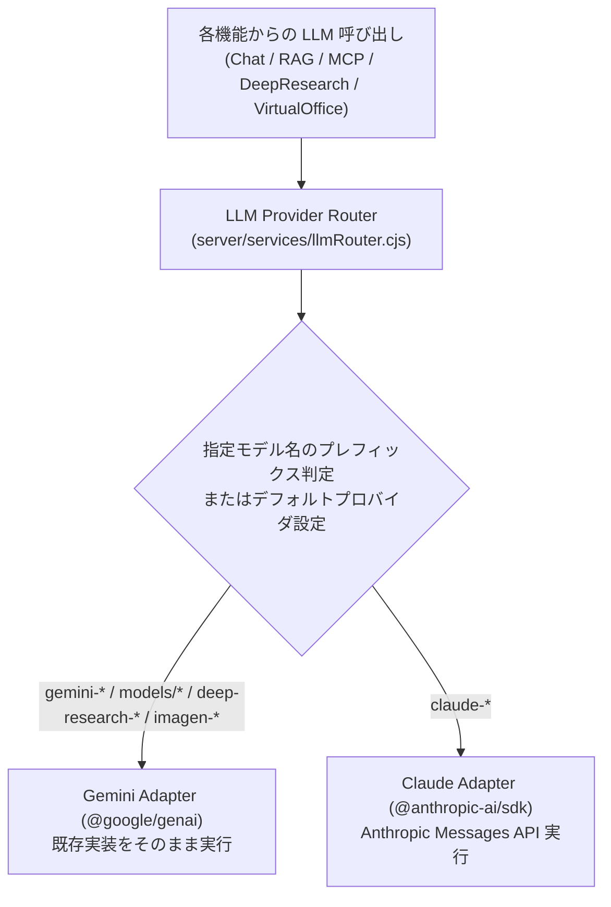
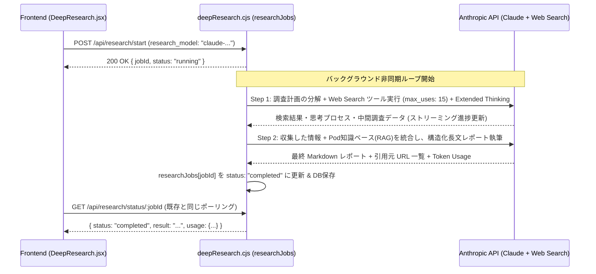

# Claude API Implementation Plan (Anthropic Claude サポートおよびマルチLLMスイッチング実装計画書)

> [!NOTE]
> **ステータス**: ペンディング（PHP および Node.js の脆弱性対応を優先するため一時保留・保存済み）

既存の Google Gemini 実装を 100% 維持したまま、Anthropic Claude（`@anthropic-ai/sdk`）を追加サポートし、System Settings から API キー設定や利用モデル・プロバイダを柔軟にスイッチ（および機能ごとに併用）できるようにするための設計・実装計画です。

---

## 1. Git ブランチ戦略とバージョン管理計画（v2.9.2 の維持と VUP）

現在の安定版 `v2.9.2` をいつでもホットフィックス・保守できる状態に保ちつつ、Claude サポートを安全に開発・段階的リリースするため、以下のブランチ構成を採ります（`MacOSUI-oss` / `MacOSUI` 両リポジトリ共通）。

1. **安定版保守ブランチの作成 (`release/v2.9.2`)**:
   - 現在の `v2.9.2` タグ（`HEAD`）から `release/v2.9.2` ブランチを切り出し、既存顧客向けの `v2.9.x` パッチ保守ラインとして保護します。
2. **Claude 開発ブランチの作成 (`feat/claude-support`)**:
   - 未コミットの作業差分（`mcpChat.cjs` 等）を保護した上で、`feat/claude-support` ブランチを作成して開発を進めます。
   - **リポジトリ間の整合性**: 最新機能（`geminiLive.cjs`、`localRag.cjs`、`ztaAudit.cjs`、最新の `SystemTab.jsx` 等）が揃っている [MacOSUI-oss](file:///Users/minoru_inui/AI%20coder/MacOSUI-oss) をプライマリとして実装・検証し、[MacOSUI](file:///Users/minoru_inui/AI%20coder/MacOSUI) へ同期します。

---

## 2. スイッチングの仕組みとモデル定義方法

### 2.1 ハイブリッド・ルーティング方式（全体スイッチ ＋ モデル名による自動判定）

ユーザーが「システム全体を Claude に切り替えたいケース」と、「Deep Research の情報収集だけ Gemini を使い、HTML レポート生成や MCP Chat は Claude を使いたいケース（適材適所の併用）」の**両方**に対応するため、以下の 2 階層スイッチを採用します。

1. **プライマリ・プロバイダ設定 (`AI_PROVIDER`)**:
   - System Settings にデフォルトプロバイダ選択（`gemini` / `claude`）を追加します。
   - モデル明示指定がない API 呼び出し（Virtual Office の 36 協定チェックや移動時間推定、DM 自動返信、タグ抽出など）は、`AI_PROVIDER` で選択されているプロバイダの基本モデル（`GEMINI_MODEL` または `CLAUDE_MODEL`）を自動的に使用します。
2. **モデル ID による自動ディスパッチ**:
   - 各画面（Chat のモデルセレクタ、Deep Research のワークフロー定義、MCP Chat 等）から渡される `model` 名が `claude-` で始まる場合は **Claude Adapter** へ、それ以外（`gemini-`、`models/`、`deep-research-`、`imagen-`）は既存の **Gemini 処理**へ自動ルーティングします。
   - これにより、既存の Gemini コードパスを一切壊さず、機能ごとのモデル選択だけでシームレスに Gemini / Claude を切り替え・混在利用できます。

### 2.2 モデル定義方法（ハードコード禁止原則への完全準拠）

`AGENTS.md` の原則（「LLM のモデル名をコード内に直接ハードコードすることは厳禁」）および ZTA/PDP 原則（`RBAC_POLICIES` の `allowed_models` による制御）に準拠し、以下の仕組みで管理します。

1. **DB 設定キー（`settings` テーブル）の追加**:
   | 設定キー | 暗号化 (`SENSITIVE_KEYS`) | 用途・説明 |
   | :--- | :---: | :--- |
   | `AI_PROVIDER` | - | システム全体の基本プロバイダ (`gemini` \| `claude`、デフォルト: `gemini`) |
   | `CLAUDE_API_KEY` | **対象 (AES暗号化)** | Anthropic API キー（`sk-ant-...`） |
   | `CLAUDE_MODEL` | - | Claude 基本モデル（System Settings で選択・変更可能） |
   | `CLAUDE_RESEARCH_MODEL` | - | Deep Research を Claude で実行する際のモデル設定 |
   | `CLAUDE_HTML_SVG_MODEL` | - | HTML/SVG 生成（Task 2 等）で優先利用するモデル設定 |
   | `CLAUDE_MCP_CHAT_MODEL` | - | MCP Chat 用のモデル設定 |
   | `CLAUDE_AVAILABLE_MODELS` | - | フォールバックおよびカスタム追加用の Claude モデル定義 JSON |

2. **動的モデル一覧取得 (`GET /api/gemini/models` の拡張)**:
   - Gemini の `client.models.list()` に加え、`CLAUDE_API_KEY` が設定されている場合は Anthropic SDK の `anthropic.models.list()`（`GET https://api.anthropic.com/v1/models`）を呼び出し、利用可能な Claude モデル一覧を動的に取得します（オフライン・エラー時は DB の `CLAUDE_AVAILABLE_MODELS` シード値をフォールバックとして使用）。
   - レスポンスの各モデルオブジェクトに `provider: 'gemini' | 'claude'` 属性を付与し、UI 側でアイコンやグループ表示を出し分けられるようにします。
   - **ZTA / RBAC 連携**: Tenant Management（`RBAC_POLICIES.allowed_models`）のモデル許可リストに Claude モデルも並列で表示・選択可能にし、PEP（認可チェック）を一元適用します。

3. **アクティベーション判定 (`isConfigured`) の拡張**:
   - [server/index.cjs](file:///Users/minoru_inui/AI%20coder/MacOSUI-oss/server/index.cjs#L947-L953) の初期セットアップ完了判定を `!!clientId && (!!geminiApiKey || !!claudeApiKey) && adminUserCount > 0` に拡張し、Claude API キーのみの顧客環境でも運用可能にします（VUP 時の再アクティベーションは一切発生しません）。

---

## 3. 機能別 実装可否マトリクスと詳細設計（できるもの・できないもの・代替案）

すべてのサブシステムを調査した結果、Claude で実装できる機能・特別な設計が必要な機能・Gemini 専用の機能の区分は以下の通りです。

| 機能カテゴリ | サブ機能 / エンドポイント | Claude 対応可否 | 実装方式・制限事項・フォールバック方針 |
| :--- | :--- | :---: | :--- |
| **1. Deep Research** | **Task 0: 計画立案 (Planning)** | **◎ 完全対応** | 通常のマルチターン対話。Claude でもそのまま動作。 |
| | **Task 1: Deep Research 実行** (`POST /api/research/start`) | **○ 拡張実装で対応** *(ハイブリッド推奨)* | Gemini は専用エージェント (`deep-research-pro-preview-12-2025` / Interactions API) を使用。 Claude 選択時は **Anthropic 内蔵 Web Search ツール (`web_search_20250305`) ＋ Extended Thinking（拡張思考）による自律マルチステップ調査ループ**をバックグラウンド実行してレポートを生成。 ※ワークフロー設定で「Task 1 は Gemini、Task 2 は Claude」のハイブリッド構成も可能。 |
| | **Task 2: HTML / SVG レポート生成** (`mode: 'html_svg'`) | **◎ 最適 (高品質)** | Claude は HTML / Tailwind / Chart.js / SVG ダイアグラム生成が極めて得意。`messages.stream`（最大出力トークン拡張）でストリーミング生成。 |
| | **Task 2: インフォグラフィック画像** (`mode: 'nanobanana'`) | **△ ラスタ画像は不可** *(代替/フォールバック)* | Claude は PNG/JPEG 等の画像生成 API を持たないため： ① `GEMINI_API_KEY` があれば Gemini 画像生成モデルへ自動フォールバック ② Claude のみの環境では **高精細 SVG インフォグラフィック生成**に自動切替（または UI で通知）。 |
| | **Task 4: タグ自動抽出** (`POST /api/research/extract-tags`) | **◎ 完全対応** | テキストからの JSON/カンマ区切り抽出。Gemini / Claude 双方で動作。 |
| **2. MCP Chat** | **ツール呼び出し & 対話ループ** (`server/routes/mcpChat.cjs`) | **◎ 完全対応** | MCP サーバーの `tools` スキーマを Claude の `input_schema` 形式に変換し、`stop_reason === 'tool_use'` ループで `callMcpTool()` を実行。 |
| | **GenUI HTML ダッシュボード合成** | **◎ 最適 (高品質)** | ツール実行結果からのインタラクティブ HTML 生成も Claude で高速・高品質に動作。 |
| | **会話履歴の継続 (`previous_interaction_id`)** | **○ DB/メモリ管理で対応** | Gemini Interactions API のサーバー側 ID の代わりに、Claude 用は `mcp_tasks`（またはセッションキャッシュ）にメッセージ履歴配列を保持してマルチターン継続を実現。 |
| **3. Chat / RAG** | **通常チャット & マルチモーダル添付** (`POST /api/gemini` `mode: 'normal'`) | **◎ 完全対応** | テキスト・画像（Base64）・PDF ドキュメント添付ともに Claude Messages API（Streaming）で完全対応。 |
| | **Web 検索グラウンディング** (`mode: 'search'`) | **◎ 完全対応** | Gemini の `google_search` に対し、Claude は Anthropic 標準の **`web_search_20250305` ツール**を有効化して最新 Web 情報に基づく回答と引用元を取得。 |
| | **Personal RAG (Google Drive 連携)** (`mode: 'rag'` / `performRagSync`) | **○ ローカルキャッシュ追加で対応** | **【重要課題と解決策】** 現在 `performRagSync` は Drive ファイルを Gemini File API (`gemini_file_uri`) にのみアップロードしている。 → Drive 同期時にテキスト/PDF 内容をローカル（または DB キャッシュ / Anthropic Document ブロック）にも保持する仕組みを追加し、Claude 選択時も Drive 同期済みドキュメントで RAG が機能するように改修する。 |
| | **Knowledge Base (Pod RAG / Local RAG)** | **◎ 完全対応** | DB から取得した記事テキスト・チャンクをプロンプトコンテキストに注入する方式のため、Claude でもそのまま 100% 動作。トークン計測も `anthropic.messages.countTokens()` で対応。 |
| **4. Virtual Office & DM** | **36協定コンプライアンスAI判定** (`POST /api/virtual-office/settings`) | **◎ 完全対応** | 労働時間ルールの JSON 審査を `AI_PROVIDER` に応じて Gemini / Claude で実行。 |
| | **カレンダー移動時間 AI 推定** (`estimateTravelTimes`) | **◎ 完全対応** | 予定間の移動手段・所要時間 JSON 推定を Gemini / Claude 双方で実行可能に。 |
| | **DM チャット AI アシスタント自動返信** (`POST /api/dm/messages`) | **◎ 完全対応** | `ai-assistant` 宛ての DM 返信を `AI_PROVIDER` の設定モデルで生成。 |
| **5. その他機能** | **Skills カスタム SVG アイコン生成** (`server/routes/skills.cjs`) | **◎ 完全対応** | 3 種類の SVG コード JSON 配列生成。Claude でも高品質に動作。 |
| | **アバター画像生成** (`POST /api/avatar/generate`) | **✕ Gemini 専用** | Step 1（顔特徴の Vision 解析）は Claude でも可能だが、Step 2（画像生成）は Gemini/Imagen 専用。Claude のみの環境では UI 上で「Gemini API キーが必要」と案内。 |
| | **TTS 音声読み上げ (`POST /api/gemini/tts`)** | **✕ Gemini 専用** | ネイティブ音声波形生成（`Modality.AUDIO`）は Gemini 専用機能として維持。 |
| | **Live Concierge (`geminiLive.cjs`)** | **✕ Gemini 専用** | 双方向リアルタイム音声 WebSocket (`BidiGenerateContent`) は Gemini 専用機能として維持。 |

---

## 4. Deep Research における Claude 実装の詳細設計

お客様からも特に関心が高い **Deep Research** について、Gemini と Claude の違いを吸収する具体的なアーキテクチャを定義します。

### 4.1 なぜ特別対応が必要か
- **Gemini の場合**: Google のサーバー側で非同期動作する専用エージェント（`agent: 'deep-research-pro-preview-12-2025'`, `background: true`）に `client.interactions.create` でジョブを投げ、`client.interactions.get(id)` でポーリングする仕組みになっています。
- **Claude の場合**: Anthropic API には単一呼び出しでバックグラウンド調査を行う `deep-research` エンドポイントは存在しないため、**MacOSUI のバックエンド（`server/routes/deepResearch.cjs`）側で非同期ジョブワーカーとして自律リサーチループを回す**必要があります。

### 4.2 Claude Deep Research エンジンの動作フロー
ワークフロー（またはリクエスト）の `research_model` に `claude-*` モデルが指定された場合、[`startDeepResearch`](file:///Users/minoru_inui/AI%20coder/MacOSUI-oss/server/routes/deepResearch.cjs#L367-L560) 内で以下のバックグラウンド処理を起動します。

- **フロントエンドへの影響ゼロ**: `researchJobs[jobId]` のステータス構造（`running` → `completed` / `failed`、経過秒数、トークン消費量 `usage`）を Gemini 実行時と完全に同一に保つため、[DeepResearch.jsx](file:///Users/minoru_inui/AI%20coder/MacOSUI-oss/src/apps/DeepResearch.jsx) のポーリングや履歴保存ロジックはそのまま動作します。
- **ハイブリッド運用のメリット**: ワークフロー定義（Task 1 のモデル・Task 2 のモデルを個別指定可能）において、
  - **パターンA（フル Claude）**: Task 1（Web調査＋執筆）も Task 2（HTML/SVG ビジュアル化）も Claude で実行
  - **パターンB（ハイブリッド・推奨）**: Task 1（広範な Web 深掘り調査）は Gemini `deep-research-pro-preview`、Task 2（ダッシュボード HTML / SVG 作成）は表現力に優れた Claude Sonnet/Opus を指定
  といった柔軟な使い分けが画面上のドロップダウン選択だけで可能になります。

---

## 5. Personal RAG（Google Drive 同期）のマルチプロバイダ対応設計

現在、[server/index.cjs](file:///Users/minoru_inui/AI%20coder/MacOSUI-oss/server/index.cjs#L1200-L1318) の `performRagSync` は Google Drive からダウンロードしたファイルを `client.files.upload` で Gemini File API にアップロードし、その URI (`gemini_file_uri`) のみを `rag_files` テーブルに記録しています。

Claude でも Personal RAG を動作させるため、以下のように拡張します：
1. **テキストキャッシュの保存**:
   - `performRagSync` で Google Docs / Sheets / Slides（エクスポート時すでにテキスト化済み）やテキスト/Markdown を取得した際、`data/rag_cache/<user_email>/<drive_file_id>.txt`（または PDF の場合は `.pdf` / 抽出テキスト）としてローカルデータディレクトリにも保存します。
   - Gemini API キーが未設定（Claude のみ設定）の環境でも、`performRagSync` がエラーにならずローカルキャッシュ同期を完了できるようにします（Gemini API キーがある場合は従来通り `gemini_file_uri` もアップロード）。
2. **Claude RAG 推論時のコンテキスト注入**:
   - `mode === 'rag'` で Claude モデルが選択された場合、ユーザーの同期済みキャッシュファイル（テキストおよび PDF ドキュメントブロック）を読み込み、Anthropic の **Prompt Caching（`cache_control: { type: 'ephemeral' }`）** を付与してシステム/ユーザーコンテキストに注入します。これにより、2 回目以降の質問でトークンコストを最大 90% 削減しつつ高速な RAG 応答を実現します。

---

## 6. 変更・新規作成ファイル一覧

### 6.1 バックエンド (Server / DB)
- **[NEW] `server/services/llmAdapter.cjs`**:
  - Gemini (`@google/genai`) と Claude (`@anthropic-ai/sdk`) の共通インターフェースを提供するアダプターモジュール。
  - 機能:
    - `isClaudeModel(modelName)` / `resolveModelAndProvider(requestedModel, taskType)`
    - `streamChat({ model, systemInstruction, messages, attachments, tools, webSearch, ragContext })`
    - `generateText({ model, prompt, systemInstruction, jsonMode })`（Virtual Office, DM, Tag 抽出, Skills 用）
    - `runClaudeDeepResearch({ jobId, prompt, systemInstruction, model, ragContext, researchJobs })`
    - `listClaudeModels(apiKey, fallbackModelsJson)`
    - `countTokens({ model, contents })`
- **[MODIFY] [package.json](file:///Users/minoru_inui/AI%20coder/MacOSUI-oss/package.json)**:
  - `@anthropic-ai/sdk` パッケージの追加（`npm audit --audit-level=critical` で脆弱性 0 件を確認）。
- **[MODIFY] [server/db_sqlite.cjs](file:///Users/minoru_inui/AI%20coder/MacOSUI-oss/server/db_sqlite.cjs) & [server/db_postgres.cjs](file:///Users/minoru_inui/AI%20coder/MacOSUI-oss/server/db_postgres.cjs)**:
  - `SENSITIVE_KEYS` に `'CLAUDE_API_KEY'` を追加（AES-256-GCM による DB 暗号化保存）。
  - デフォルト設定シードに `AI_PROVIDER` (`'gemini'`), `CLAUDE_MODEL`, `CLAUDE_RESEARCH_MODEL`, `CLAUDE_HTML_SVG_MODEL`, `CLAUDE_MCP_CHAT_MODEL`, `CLAUDE_AVAILABLE_MODELS` を追加。
- **[MODIFY] [server/index.cjs](file:///Users/minoru_inui/AI%20coder/MacOSUI-oss/server/index.cjs)**:
  - `GET /api/config` / `POST /api/config`: Claude 関連設定と `hasClaudeApiKey` マスク情報の返却・保存に対応。
  - `GET /api/gemini/models`: Gemini モデル一覧と Claude モデル一覧を統合して返却（`provider` 属性付き）。
  - `processGeminiJob` (`POST /api/gemini`): 選択されたモデルが Claude の場合、`llmAdapter.streamChat` へルーティング（`normal`, `search`, `rag`, `html_svg` モード対応、`nanobanana` のフォールバック処理）。
  - `performRagSync`: Drive ファイル同期時に Claude 用のローカルキャッシュ保存を追加し、`GEMINI_API_KEY` が無く `CLAUDE_API_KEY` のみの環境でも同期可能に改修。
  - Virtual Office（36協定チェック・移動時間推定）および DM AI 自動返信を `llmAdapter.generateText` 経由に統一。
- **[MODIFY] [server/routes/deepResearch.cjs](file:///Users/minoru_inui/AI%20coder/MacOSUI-oss/server/routes/deepResearch.cjs)**:
  - `startDeepResearch`: `research_model` が Claude の場合に `llmAdapter.runClaudeDeepResearch` を呼び出す分岐を追加。
  - `POST /api/research/extract-tags`: `llmAdapter.generateText` 経由に改修し、Gemini / Claude 両対応。
- **[MODIFY] [server/routes/mcpChat.cjs](file:///Users/minoru_inui/AI%20coder/MacOSUI-oss/server/routes/mcpChat.cjs)**:
  - MCP Chat のモデル設定で Claude が選択された場合、Anthropic `messages.create` の `tools` / `tool_use` / `tool_result` ループと HTML GenUI 合成を実行する処理を追加。
- **[MODIFY] [server/routes/knowledge.cjs](file:///Users/minoru_inui/AI%20coder/MacOSUI-oss/server/routes/knowledge.cjs) & [server/routes/skills.cjs](file:///Users/minoru_inui/AI%20coder/MacOSUI-oss/server/routes/skills.cjs)**:
  - トークンカウントおよび SVG アイコン生成を `llmAdapter` 経由で Claude にも対応。

### 6.2 フロントエンド (UI)
- **[MODIFY] [src/apps/SystemSettings/SystemSettings.jsx](file:///Users/minoru_inui/AI%20coder/MacOSUI-oss/src/apps/SystemSettings/SystemSettings.jsx) & [src/apps/SystemSettings/tabs/SystemTab.jsx](file:///Users/minoru_inui/AI%20coder/MacOSUI-oss/src/apps/SystemSettings/tabs/SystemTab.jsx)**:
  - **AI プロバイダ切り替え UI**: デフォルトプロバイダ（`Google Gemini` / `Anthropic Claude`）の選択トグル。
  - **Anthropic Claude 設定セクション**:
    - `Claude API Key` の入力欄（設定済みバッジ表示・暗号化保存対応）。
    - `Claude Base Model`、`Claude Research Model`、`Claude HTML/SVG Model`、`Claude MCP Chat Model` の選択ドロップダウン。
- **[MODIFY] [src/components/SetupScreen.jsx](file:///Users/minoru_inui/AI%20coder/MacOSUI-oss/src/components/SetupScreen.jsx)**:
  - 初期セットアップ画面でも Gemini API キーまたは Claude API キー（あるいは両方）を入力可能に拡張。
- **[MODIFY] [src/apps/Gemini.jsx](file:///Users/minoru_inui/AI%20coder/MacOSUI-oss/src/apps/Gemini.jsx), [src/apps/DeepResearch.jsx](file:///Users/minoru_inui/AI%20coder/MacOSUI-oss/src/apps/DeepResearch.jsx), [src/apps/McpChat.jsx](file:///Users/minoru_inui/AI%20coder/MacOSUI-oss/src/apps/McpChat.jsx)**:
  - モデル選択ドロップダウンで Gemini / Claude モデルをプロバイダ別に分かりやすく表示。
  - Claude モデル選択時にラスタ画像生成（NanoBanana）が選ばれた場合のガイド表示または SVG モードへの誘導。

---

## 7. 検証・品質保証計画 (Built-in Quality)

1. **構文・ビルド検証**:
   - `node -c server/index.cjs` および新規・変更 `.cjs` ファイルの構文チェック
   - `npm run build` によるフロントエンドビルド成功確認
   - `npm audit --audit-level=critical` で CRITICAL 脆弱性 0 件の確認
2. **回帰テスト（Gemini 既存機能の完全維持確認）**:
   - `AI_PROVIDER = 'gemini'` かつ Gemini モデル選択時に、Chat / RAG / Deep Research / MCP Chat / Virtual Office が従来通り 100% 動作することを確認。
3. **Claude スイッチング動作検証**:
   - System Settings での `CLAUDE_API_KEY` 保存（DB 暗号化確認）とモデル一覧取得
   - Claude モデルでの通常チャット、Web 検索、Personal RAG、MCP ツール実行、Deep Research（Task 0〜Task 4）、Virtual Office 連携の動作確認。
