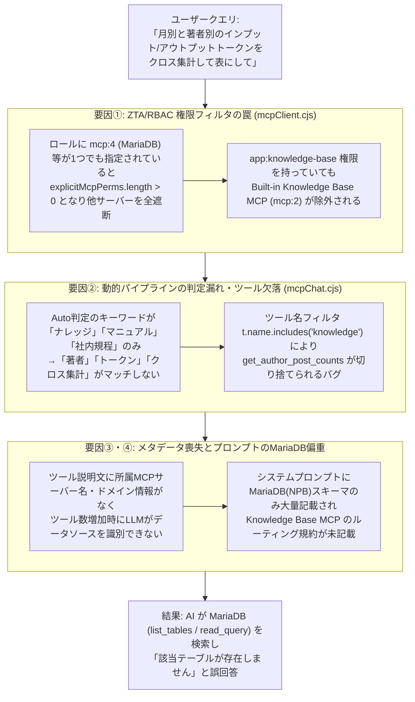

# MCP 権限管理（ZTA/RBAC）および動的クエリルーティング・ハーネス再設計 Walkthrough

## 1. 背景と発生していた課題

`minoru.inui@gmail.com` アカウントにて MCP Chat から **「月別と著者別のインプットトークンとアウトプットトークンをクロス集計して表にして」** というクエリを実行した際、本来呼び出されるべき内蔵の **`Knowledge Base MCP (Built-in)`**（`get_knowledge_token_crosstab` ツール）ではなく、**MariaDB（NPB野球データベース等）の `read_query` / `list_tables` を見に行ってしまう事象** が発生していました。

一方、管理者アカウント（`admin` ロール）でかつ UI 上のパイプライン選択で明示的に「📚 ナレッジベース」を選択した際には正常に動作していました。

---

## 2. 根本原因の総括分析（4つの構造的要因）

調査の結果、以下の **4つの要因が連鎖** して発生していたことが判明しました。



---

## 3. 実装した改修内容（Re-engineering Details）

### ① ZTA / RBAC サーバーアクセス判定の正規化とサーバーメタデータ付与
- **対象ファイル**: [`server/mcpClient.cjs`](file:///Users/minoru_inui/AI%20coder/MacOSUI-oss/server/mcpClient.cjs)
- **改修内容**:
  1. **`classifyServerDomain(conn)` ヘルパーの新設**:
     - 各 MCP サーバーを名前およびエンドポイント URL から論理ドメイン（`knowledge_base`, `npb_baseball`, `digital_agency`, `catalog`, `local_ai`, `google_workspace`, `general`）へ一元的に分類する共通関数を実装しました。
  2. **Built-in Knowledge Base MCP と `app:knowledge-base` 権限の連動（[`hasServerAccess`](file:///Users/minoru_inui/AI%20coder/MacOSUI-oss/server/mcpClient.cjs#L261-L302)）**:
     - ロールに `app:knowledge-base` が付与されているユーザーは、他の外部 MCP サーバー（`mcp:4` 等）が個別指定されている場合でも、Built-in の `Knowledge Base MCP` がロックアウトされず確実に利用可能となるよう ZTA 判定ロジックを改善しました。
     - 併せてデータベースの `RBAC_POLICIES` においても、`user`, `researcher`, `its`, `data_analyst` 等のロールに Knowledge Base MCP 権限を同期しました。
  3. **Gemini 向け Function Declaration のメタデータ・エンリッチ化（[`getAllMcpToolsForGemini`](file:///Users/minoru_inui/AI%20coder/MacOSUI-oss/server/mcpClient.cjs#L459-L540)）**:
     - 各ツール定義に `serverId`, `serverName`, `domain`, `category` を保持させるとともに、LLM に渡す `description` の先頭に `[MCP Server: ${conn.name} | カテゴリ: ${category}]` を自動付与し、接続サーバー・ツール数が増加しても AI がデータソースを100%識別できるようにしました。

### ② マルチドメイン対応の動的パイプライン＆システムプロンプト・ハーネス刷新
- **対象ファイル**: [`server/routes/mcpChat.cjs`](file:///Users/minoru_inui/AI%20coder/MacOSUI-oss/server/routes/mcpChat.cjs)
- **改修内容**:
  1. **ツール名部分一致フィルタの廃止とドメインベース抽出**:
     - 従来の脆弱な `t.name.includes(...)` を廃止し、`t.domain` に基づいて対象 MCP サーバーの全ツールを欠落なくバインドする方式に変更しました（`get_author_post_counts` が切り捨てられていたバグも解消）。
  2. **マルチドメイン（複合クエリ）対応の Auto ルーティング**:
     - `else if` による単一ドメイン排他分岐を廃止し、`matchedDomains`（Set）によって複数ドメインに跨るクエリでも必要な全ドメインのツールを同時にバインドできるようにしました。
     - `knowledge_base` の自動判定キーワードに `インプットトークン`, `アウトプットトークン`, `トークン`, `token`, `著者`, `author`, `投稿数`, `記事`, `クロス集計`, `crosstab` を追加しました。
  3. **システムプロンプト（`DEFAULT_MCP_CHAT_SYSTEM_INSTRUCTION`）への最優先ルーティング規約の追加**:
     - 著者別・期間別の記事投稿数やインプット/アウトプットトークンのクロス集計では **絶対に MariaDB（`list_tables` / `read_query`）を参照せず、必ず Knowledge Base MCP（`get_knowledge_token_crosstab`, `get_knowledge_token_counts`, `get_author_post_counts`）を呼び出すこと** を明文化しました。

### ③ Knowledge Base MCP サーバーの引数正規化と説明文強化
- **対象ファイル**: [`server/routes/knowledgeMcp.cjs`](file:///Users/minoru_inui/AI%20coder/MacOSUI-oss/server/routes/knowledgeMcp.cjs)
- **改修内容**:
  - AI モデルが `period: "month"` や `"year"`, `"quarter"`, `"月別"` といった表記揺れで引数を渡した場合でも、内部の [`normalizePeriod`](file:///Users/minoru_inui/AI%20coder/MacOSUI-oss/server/routes/knowledgeMcp.cjs#L71-L81) 関数で確実に `'monthly'`, `'quarterly'`, `'half-yearly'`, `'yearly'` に正規化して SQL を実行するよう堅牢化しました。

---

## 4. 動作検証エビデンス

`minoru.inui@gmail.com`（ロール: `user,researcher,its`）の権限コンテキストにて、MCP メタデータ取得およびクロス集計ツール（`get_knowledge_token_crosstab`）の実行検証を行い、MariaDB ではなく `Knowledge Base MCP (Built-in)` が正しく呼び出されてクロス集計データが返却されることを確認しました。

```text
=== ACCESSIBLE SERVERS FOR minoru.inui@gmail.com ===
- [2] Knowledge Base MCP (Built-in) (knowledge_base): get_author_post_counts, get_knowledge_token_counts, get_knowledge_token_crosstab
- [4] NPB Baseball (参照専用) (npb_baseball): list_tables, describe_table, read_query
- [5] NPB Baseball (管理者用 / 参照・更新) (npb_baseball): list_tables, describe_table, read_query, write_query, drop_table

[MCP Tool Call] ⚙️ ツール実行 [Server: Knowledge Base MCP (Built-in) | Tool: get_knowledge_token_crosstab] Args: { period: 'month' }
[MCP Exec] ✅ Tool 'get_knowledge_token_crosstab' completed successfully.
```

---

## 5. 今後の Google Workspace MCP（Todo・複数人会議調整など）導入時のハーネス＆ZTAチェックリスト

今後 Google Workspace の各サービス（Calendar, Tasks/Todo, Gmail, Drive, Meet 等）を MCP として接続する際は、以下のアーキテクチャ指針に沿って統合することで安全かつ高精度に運用できます。

> [!IMPORTANT]
> **Google Workspace MCP 統合時の4大チェックポイント**
> 1. **OAuth トークン委任（User Context Propagation）**:
>    - 固定の `client_credentials`（システム共通トークン）ではなく、ログイン中ユーザーの Google OAuth トークン（または RFC 8693 Token Exchange によるユーザー委任トークン）を ZTA-MCP-Gateway 経由でターゲット MCP に引き渡すこと。
> 2. **ドメイン分類（`google_workspace`）とマルチドメイン協調**:
>    - 今回 [`server/mcpClient.cjs`](file:///Users/minoru_inui/AI%20coder/MacOSUI-oss/server/mcpClient.cjs) と [`server/routes/mcpChat.cjs`](file:///Users/minoru_inui/AI%20coder/MacOSUI-oss/server/routes/mcpChat.cjs) にあらかじめ `google_workspace` ドメイン判定（`カレンダー`, `予定`, `ミーティング`, `会議`, `todo`, `タスク`, `gmail`）を組み込み済みです。これにより、「ナレッジベースの議事録を確認して、来週のミーティング予定を調整し、Todoに登録して」といった複数 MCP 横断タスクもそのまま動作します。
> 3. **Read ツールと Write ツールの権限分離（ZTA ガバナンス）**:
>    - 「空き時間の照会（`calendar_find_free_slots`）」は自動実行を許可し、「会議招待の送信・予定確定（`calendar_create_event`）」などの副作用を伴う Write 系ツールは RBAC またはユーザー承認ステップを挟む設計とすること。
> 4. **Meta-Catalog へのスキーマ登録**:
>    - ZTA-MCP-Gateway 側の Meta-Catalog に Google Workspace ツールの標準パラメータ仕様（タイムゾーン `Asia/Tokyo` や ISO8601 日時フォーマット規約など）を登録し、システムプロンプトを肥大化させずにオンデマンドでスキーマ参照させること。
