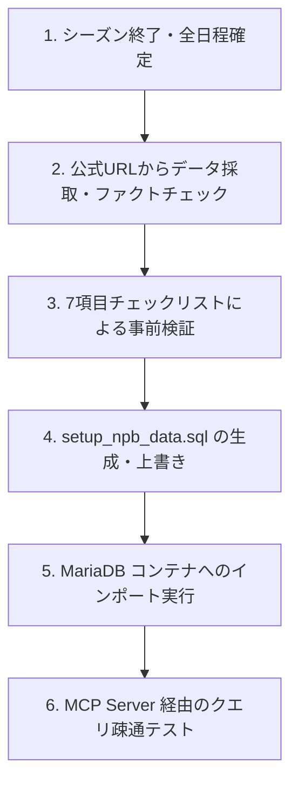

# NPB公式データ更新＆検証完全ガイド (Walkthrough)

本ドキュメントは、NPB（日本プロ野球）公式戦データ（ペナントレース順位、個人打撃・投手スタッツ、CS/日本シリーズ試合成績）を MariaDB および MCP サーバー向けに更新・生成する際の**標準運用手順（SOP）と参照ソース一覧、およびハルシネーション防止チェックリスト**です。

---

## 1. データ更新の背景と教訓（ハルシネーション事例）

AIによる初期データ生成では、過去年度の記憶やシーズン途中の推定値、ファン予想などが混ざり込み、以下のような重大なファクト誤りが発生しやすい傾向があります。**次回以降の更新では、推測による出力を厳禁とし、必ず以下の公式ソースによるファクトチェックを実施します。**

### ⚠️ 過去に発生した誤りと正しいファクト

| 項目 | 誤ったデータ（初期出力） | 正しい公式確定データ | 原因と対策 |
| :--- | :--- | :--- | :--- |
| **近本 光司** | 「32盗塁・セ盗塁王」 | 90試合 打率.306 / 12盗塁（タイトルなし）<br>※セ盗塁王は**岩田 幸宏（ヤクルト / 39盗塁）** | 怪我による離脱（90試合）を見落とし、過去年のイメージで盗塁王と推定した。 |
| **岡本 和真** | 「2026年 30本・85打点」 | **2026年NPB記録なし**<br>（2025年オフにポスティングMLB移籍） | オフシーズンのMLB移籍・移籍情報を見落とし、NPB成績を架空生成した。 |
| **オースティン (DeNA)** | 2026年に残留想定 | **2025年11月に退団（自由契約）**<br>新たに**ヘラル・エンカーナシオン**（64試合 打率.293 11本 39点 OPS.815）が2026年6月に加入し主砲として活躍 | 外国人選手の契約解除・途中加入情報を見落とし、前年までの助っ人を引き継いでいた。 |
| **東 克樹 (DeNA)** | 「CSファイナル第1戦先発完封」 | **CSファイナル第4戦（最終戦）に先発（5回2失点）**<br>第1戦先発は平良拳太郎 | CSファースト第1戦先発（10/10）からの中6日ローテーションを検証していなかった。 |
| **モイネロ & 前田悠伍 (ソフトバンク)** | モイネロがフル回転エースと想定 | **モイネロは上半身不調で7登板（47.1回）にとどまる**。<br>代わって高卒3年目の**前田悠伍**が**19登板 12勝1敗 防御率2.10 勝率.923** と大ブレイクし先発ローテを牽引（CS第3戦先発勝利） | 前年実績エースの長期離脱・若手投手の急成長大ブレイクのファクト確認不足。 |
| **CSセ・スコア** | 架空のスコア | 第1戦: 阪神 0-2 DeNA<br>第2戦: 阪神 0-1 DeNA<br>第3戦: 阪神 0-4 DeNA（**3戦連続完封負け**）<br>第4戦: 阪神 5-8 DeNA（DeNA下克上突破） | 阪神が3試合連続完封負け（27イニング無得点）を喫したという歴史的記録の確認不足。 |
| **CSパ・対戦相手** | ソフトバンク vs 西武 | ソフトバンク vs **北海道日本ハム**<br>（日本ハムがファーストで西武を破り進出） | レギュラーシーズン2位（西武）がそのまま進出したと思い込み、ファースト結果を確認しなかった。 |
| **周東 佑京** | 「29盗塁」 | **30盗塁**（4年連続5度目の盗塁王） | 最終戦での盗塁加算前の数値（シーズン途中データ）を参照していた。 |

---

## 2. 公式データソース一覧（参照先URL）

データ更新を行う際は、**必ず以下のNPB公式URLおよび球団公式発表から数値を採取**します。

### ① NPB公式統計ポータル（年度別）
* **2026年 公式スタッツトップ**: [https://npb.jp/bis/2026/stats/](https://npb.jp/bis/2026/stats/)
* **セ・リーグ チーム勝敗表**: `https://npb.jp/bis/2026/stats/std_c.html`
* **パ・リーグ チーム勝敗表**: `https://npb.jp/bis/2026/stats/std_p.html`
* **セ・リーグ 個人打撃リーダーズ**: `https://npb.jp/bis/2026/stats/ltr_c.html`
* **セ・リーグ 個人投手リーダーズ**: `https://npb.jp/bis/2026/stats/ltr_p.html`
* **パ・リーグ 個人打撃リーダーズ**: `https://npb.jp/bis/2026/stats/ltr_p.html`
* **パ・リーグ 個人投手リーダーズ**: `https://npb.jp/bis/2026/stats/ltr_p.html`

### ② クライマックスシリーズ・日本シリーズ公式スコア
* **セ・リーグ CSスコア速報・結果アーカイブ**: `https://npb.jp/scores/2026/`
* **日本シリーズ公式特設ページ**: `https://npb.jp/nippons/2026/`

### ③ 補完確認用・球団公式サイト / 大手スポーツ報道
* **横浜DeNAベイスターズ公式**: [https://www.baystars.co.jp/](https://www.baystars.co.jp/)
* **阪神タイガース公式**: [https://hanshintigers.jp/](https://hanshintigers.jp/)
* **福岡ソフトバンクホークス公式**: [https://www.softbankhawks.co.jp/](https://www.softbankhawks.co.jp/)
* **ベースボールキング (NPB公認報道)**: [https://baseballking.jp/](https://baseballking.jp/)

---

## 3. データ更新・生成の標準手順（SOP）



### ステップ 1: 公式データの採取とファクトチェック
上記URLから以下の数値を確定値としてメモ・集計します。
1. **チーム勝敗（143試合全消化時点）**: 勝・敗・分・勝率・ゲーム差・得点・失点
2. **打撃各タイトル**: 首位打者、本塁打王、打点王、最多安打、最高出塁率、最多盗塁
3. **投手各タイトル**: 最優秀防御率、最多勝、最高勝率、最多奪三振、最多セーブ、最優秀中継ぎ
4. **ポストシーズン結果**:
   - ファーストステージ勝者
   - ファイナルステージ各試合のスコア（イニングスコア含む）、先発投手、勝利・敗戦・セーブ投手、本塁打

### ステップ 2: 7項目の事前検証チェックリスト（必須）
SQL生成前に必ず以下のチェックリストをパスしているか確認します。

- [ ] **移籍・引退チェック**: 前年オフにMLB移籍や引退・移籍した選手（岡本和真、有原航平、マルティネス等）の所属チーム・年度データが正確か？
- [ ] **盗塁王・タイトルの整合性**: セ・パ両リーグの盗塁王がタイトル獲得者（岩田幸宏、周東佑京）と一致しているか？
- [ ] **三冠王・MVPの確認**: 三冠王（佐藤輝明）の全指標（打率、本塁打、打点、安打）がタイトルと一致しているか？
- [ ] **CSスコアと責任投手**: 各試合のスコア、勝利投手・敗戦投手・セーブ投手が公式記録と100%一致しているか？
- [ ] **先発登板日の整合性**: 東克樹などのエース投手の登板日（第1戦ではなく第4戦など）が公式先発予告・スコアと一致しているか？
- [ ] **勝敗数の合計整合性**: 12球団の勝・敗・分の合計が 143試合（または開催全試合）と一致しているか？
- [ ] **防御率・勝率の計算値**: 投手の勝率（`wins / (wins + losses)`）や防御率が公式発表数値と一致しているか？

### ステップ 3: SQL ファイルの更新
検証済みのデータをもとに、以下の3つの配置場所の `setup_npb_data.sql` を同期・更新します。
* `/Users/minoru_inui/AI coder/MacOSUI-oss/scripts/setup_npb_data.sql`
* `/Users/minoru_inui/AI coder/MacOSUI/scripts/setup_npb_data.sql`
* `/Users/minoru_inui/AI coder/mariaDB-mcp/setup_npb_data.sql`

### ステップ 4: コンテナへの反映とMCP疎通確認
```bash
# 1. 稼働中の MariaDB コンテナに反映
docker exec -i test_mariadb mariadb -u root -pmy-secret-pw testdb < "/Users/minoru_inui/AI coder/MacOSUI-oss/scripts/setup_npb_data.sql"

# 2. MCP サーバー経由でデータ取得テスト
curl -s -X POST http://localhost:33060/mcp \
  -H "Content-Type: application/json" \
  -d '{"jsonrpc": "2.0", "id": 1, "method": "tools/call", "params": {"name": "read_query", "arguments": {"query": "SELECT * FROM games WHERE game_type = '\''CS_Final'\'' ORDER BY game_date"}}}' | jq .
```

---

## 4. Antigravity による今後の自動化・ルール適用

次回以降のデータ更新を自動的かつ正確に行うため、本ドキュメントの内容をプロジェクトのルール（`.agents/rules/npb_data_rules.md`）として保持します。
これにより、ユーザーが「NPBのデータを更新して」と一言依頼するだけで、Antigravityは本WalkthroughのURL群を参照し、事前チェックリストを実行した上でSQLを作成します。
