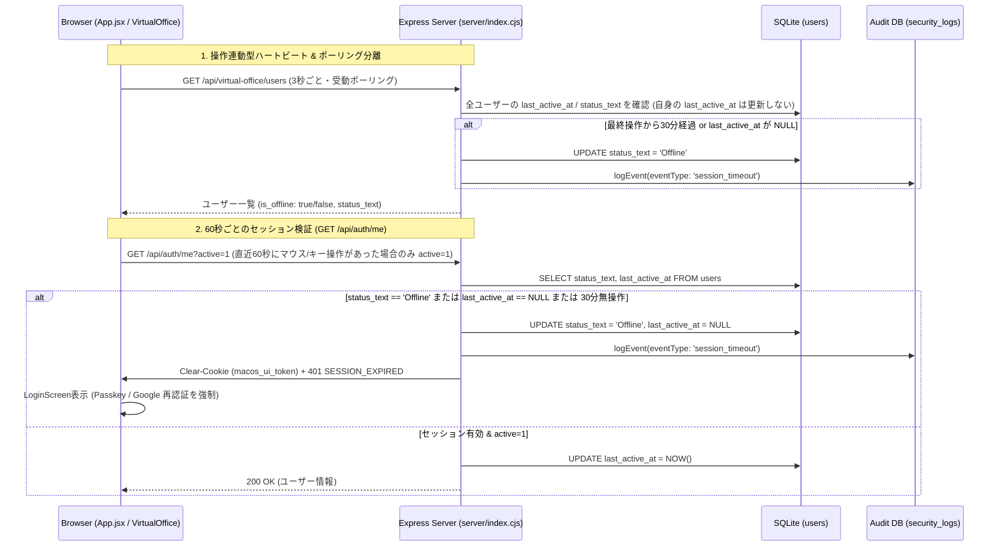

# バーチャルオフライン処理 & ZTA準拠セッションタイムアウト制御 Walkthrough

## 1. 背景と発生していた課題

バーチャルオフィス（Virtual Office）のオンライン/オフライン状態管理および Employee Agent (EA) のセッションタイムアウト処理において、以下の3点の課題が確認されました。

1. **未ログイン・放置ユーザーがバーチャルオフィスで `Offline` にならない問題**
   - DB上で `last_active_at` が `NULL` のユーザー（未ログインまたはログアウト済みでステータス文字列のみ `'Active'` が残っていたユーザー）に対し、従来の `isUserOffline()` が `false`（オンライン）を返していた。
   - バーチャルオフィスの3秒ポーリング（`GET /api/virtual-office/users`）および60秒ごとのセッション確認（`GET /api/auth/me`）が、ユーザーの実際の操作有無にかかわらず無条件に `last_active_at` を現在時刻で更新していたため、画面を開いている限り永久にアイドルタイムアウトしない状態だった。
2. **タイムアウト/ログアウト後にブラウザをリフレッシュ（F5）すると再ログインなしで復帰してしまう問題（ZTA違反）**
   - Cookie（`macos_ui_token`）のJWT有効期限が7日間である一方、`GET /api/auth/me` が呼ばれた際に DB 上の `status_text === 'Offline'` や `last_active_at === NULL` を検証せず、無条件に `status_text = 'Active'` に書き換えてセッションを復活させていた。
3. **5分程度の短時間で意図せずログイン画面に戻される問題**
   - サーバー再起動時の一時的な `502 Bad Gateway` や、Google Drive / Calendar OAuth トークン未連携エラー（旧ステータス `401`）をフロントエンドの `src/App.jsx` が「MacOSUIのセッション切れ」と誤認して強制ログアウト処理を発火させていた。

---

## 2. アーキテクチャおよび制御フローの変更（ZTA準拠）

---

## 3. 具体的な修正内容

### 3.1 サーバーサイド（`server/index.cjs`）

#### ① Cookie 破棄ヘルパー `clearSessionCookie(req, res)` の新設
ログイン時の `res.cookie('macos_ui_token', ...)` と完全に同一の属性（`httpOnly: true`, `sameSite: 'lax'`, `secure`, `path: '/'`）で確実にブラウザの Cookie を消去するヘルパー関数を実装しました。

#### ② `isUserOffline(user, currentLoginUserId)` の判定ロジック修正
- `user.status_text === 'Offline'` の場合は即座に `true`（Offline）。
- `!user.last_active_at`（`NULL` または未定義）の場合も `true`（Offline）を返すように修正。
- 最終操作時刻（`last_active_at`）から `SESSION_IDLE_TIMEOUT_MS`（30分）を超過している場合に `true`（Offline）を返します。

#### ③ `GET /api/auth/me`・`requireAuth`・`requireAuthOrA2A` における ZTA セッション検証と F5 復活防止
- JWT トークンの署名が有効であっても、DB上のユーザーが以下のいずれかに該当する場合はセッション失効（`401 SESSION_EXPIRED`）として拒否し、Cookie を破棄します。
  1. `user.status_text === 'Offline'` または `!user.last_active_at`（既にログアウトまたはタイムアウト済み）
  2. `Date.now() - Date.parse(user.last_active_at) > SESSION_IDLE_TIMEOUT_MS`（30分以上の無操作によるサーバーサイド・アイドルタイムアウト）
- これにより、一度タイムアウトやログアウトが発生した後にブラウザを F5 リフレッシュしても、勝手に `'Active'` に復活することはなく、必ず Passkey または Google OAuth による再認証が要求されます。

#### ④ 受動ポーリングによる `last_active_at` 自動延長の廃止
- `GET /api/virtual-office/users`（3秒ごとのバックグラウンドポーリング）でリクエスト送信者の `last_active_at` を無条件更新していた処理を削除しました。
- `GET /api/auth/me` でも、クエリパラメータ `?active=1` が付与されている場合（フロントエンドで実際の入力操作があった場合）のみ `last_active_at` を更新するように変更しました。

#### ⑤ 外部OAuthトークン未連携時のエラーステータス分離
- `getDriveClient` および `getCalendarClient` において、対象ユーザーの Google OAuth トークンが未登録の場合に `401` ではなく `403 ({ code: 'GOOGLE_TOKEN_MISSING' })` を返すように変更しました。これにより、バーチャルオフィスで他ユーザーのカレンダー等を参照した際に自身の MacOSUI セッションが強制ログアウトされる問題を解消しました。

---

### 3.2 フロントエンド（`src/App.jsx`）

- **実操作の検知（`hasRecentActivityRef`）とDOM再描画（バッジ表示等）による疑似イベント排除**:
  - `mousemove`, `mousedown`, `keydown`, `touchstart`, `wheel`, `click` イベント発生時に `hasRecentActivityRef.current = true` を記録し、60秒ごとの `checkSession` 実行時に直近の操作があった場合のみ `/api/auth/me?active=1` を呼び出すようにしました。
  - **疑似 `mousemove` の無視**: バーチャルオフィス画面の3秒ポーリングや未読バッジのポップアップ等によりカーソル直下のDOMが再描画された際、ブラウザ（Blink/Chrome）が同一座標で発火させる疑似 `mousemove` イベントを無視するため、マウス座標が3px以上実際に移動した場合のみ実操作と判定するようにしました。
  - **`useEffect` 依存配列のプリミティブ化（`user?.id`）**: 60秒ごとの `checkSession` で `setUser(data.user)` が新しいオブジェクト参照を返した際に `useEffect` が再実行されて `lastActivityRef.current` や `hasRecentActivityRef.current` が毎分リセットされてしまう無限ループを防止するため、依存配列を `[userId, ...]` に変更し、さらに `silent` チェック時はユーザー属性に変化がなければ既存の参照を維持するようにしました。
- **一時的なネットワーク/サーバー再起動エラーでの誤ログアウト防止**:
  - `checkSession(true)` において、`res.status === 401 || res.status === 403` の場合のみ `forceLogoutWithNotice` を実行し、コンテナ再起動中の一時的な `502 Bad Gateway` 等ではログアウトさせないように修正しました。
- **タイムアウト理由のサーバー通知**:
  - クライアント側の30分無操作タイマー発火時、`POST /api/auth/logout` に `{ reason: 'session_timeout' }` を送信し、サーバー側で確実に `event_type: 'session_timeout'` の監査ログを記録するようにしました。

---

### 3.3 セキュリティ監査ログ UI（`src/apps/SystemSettings/tabs/SecurityLogsTab.jsx`）

- イベント種別フィルタに **「セッションタイムアウト (ZTA)」**（`timeout` / `session_timeout`）を追加しました。
- ログ一覧テーブルにオレンジ色の `⏱️ ZTA Timeout` バッジが表示されるようになりました。
